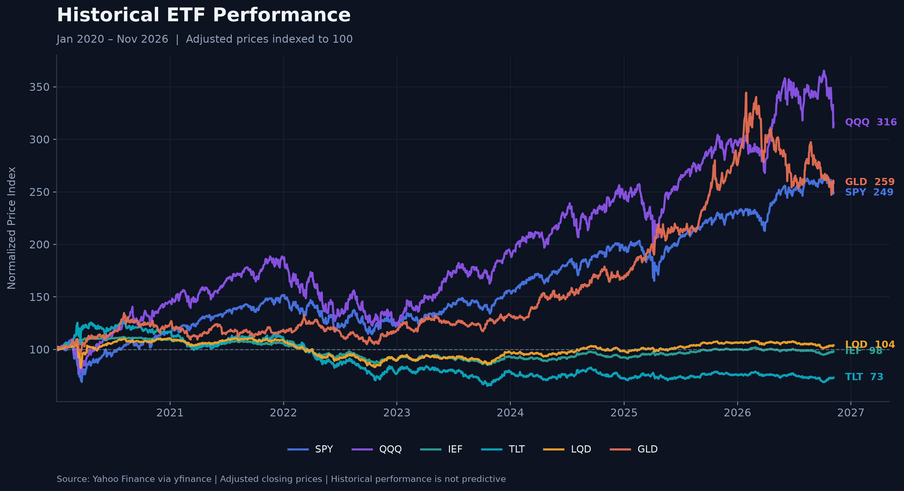
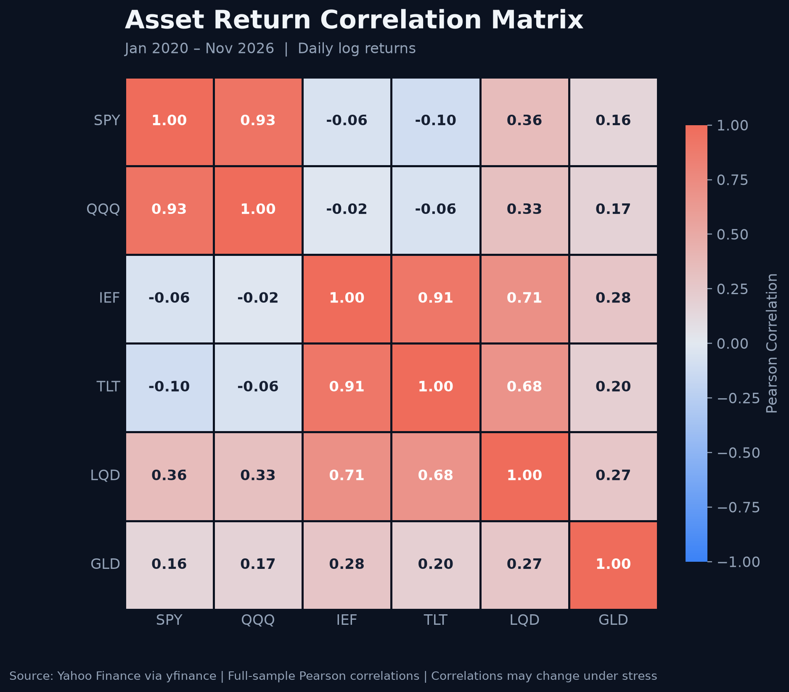

# Portfolio Risk & Loss Probability Simulation

## Overview

This project applies Monte Carlo simulation to assess the potential future losses of a multi-asset investment portfolio.

Using historical market data and correlated asset return simulations, the model estimates portfolio P&L distributions, tail risk measures, and the probability of exceeding predefined loss thresholds.

## Key Research Question

What is the probability that a $100 million multi-asset portfolio loses more than 5% over the next 20 trading days?

## Methodology

1. Construct a multi-asset portfolio covering equities, Treasury bonds, corporate credit, and gold.
2. Estimate historical asset returns, volatility, and correlations.
3. Generate correlated asset returns using Monte Carlo simulation.
4. Simulate portfolio values over a 20-trading-day horizon.
5. Calculate portfolio P&L distributions, Value at Risk (VaR), Expected Shortfall (ES), and loss probabilities.
6. Evaluate sensitivity to volatility and correlation assumptions under stressed market conditions.

## Exploratory Market Risk Analysis

### Historical ETF Performance

The chart below compares the cumulative performance of six ETFs
using adjusted closing prices normalized to an initial value of 100.

### Historical Asset Correlations

The correlation matrix illustrates relationships between daily
log returns across equities, Treasury bonds, corporate credit,
and gold.

### Preliminary Findings

- **Equity concentration:** SPY and QQQ exhibit a strong positive
  correlation of approximately 0.93, limiting diversification
  benefits between the two positions.
- **Treasury exposure:** IEF and TLT exhibit a correlation of
  approximately 0.91, reflecting shared interest-rate sensitivity.
- **Corporate credit:** LQD is positively correlated with both
  Treasury bonds and equities, reflecting its combined interest-rate
  and credit-spread exposures.
- **Gold diversification:** GLD exhibits relatively low historical
  correlations with equities, although its standalone volatility
  remains material.

These historical relationships form the basis for estimating
the covariance matrix used in the Monte Carlo simulation.

**Data period:** January 2020 – November 2026  
**Data source:** Yahoo Finance via yfinance  
**Methodology:** Daily adjusted prices and logarithmic returns

## Planned Visualizations

- Portfolio P&L Distribution
- Monte Carlo Portfolio Value Paths
- Portfolio Value Fan Chart
- Asset Correlation Heatmap
- Base vs. Stress Scenario Comparison
- Risk Metrics and Tail Loss Analysis

## Tools

Python, NumPy, pandas, SciPy, Matplotlib, Plotly

## Project Status

In Development
