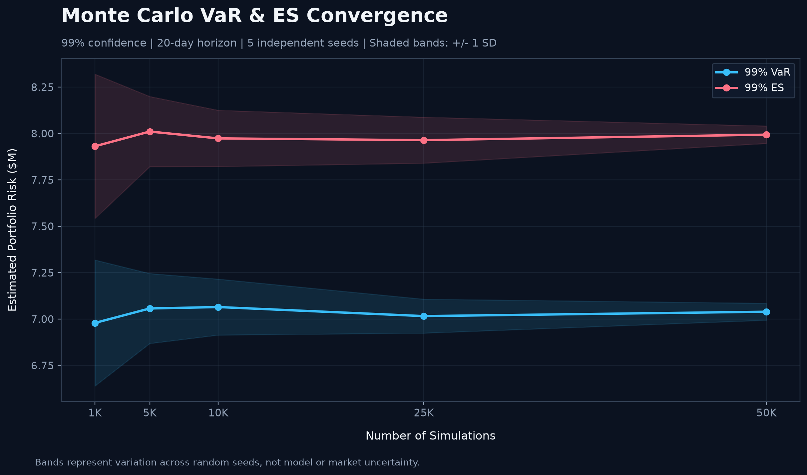
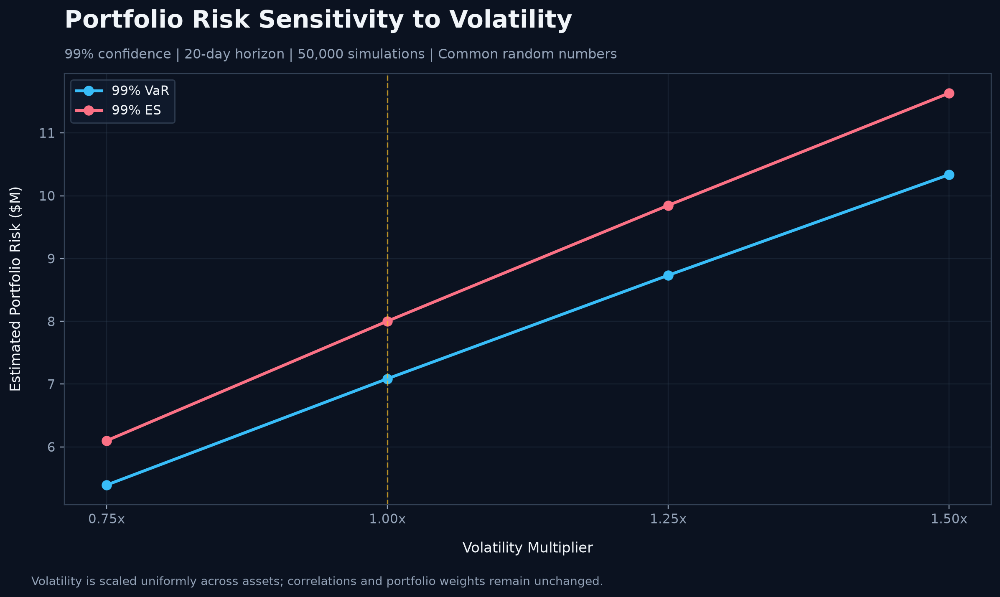
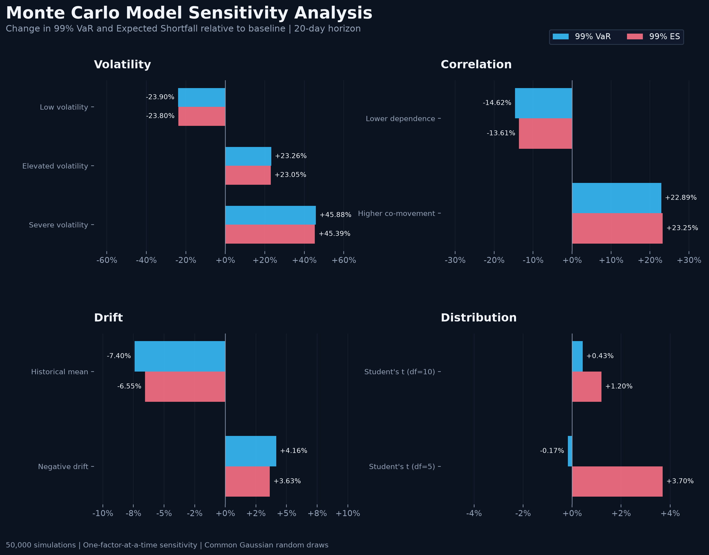

# Portfolio Risk & Loss Probability Simulation

## 1. Executive Summary

This project develops a Monte Carlo simulation framework to quantify the downside risk of a $100 million multi-asset ETF portfolio over a 20-trading-day horizon. Using historical return covariance estimates, the model generates 50,000 correlated return paths to estimate portfolio Value at Risk (VaR), Expected Shortfall (ES), and loss probabilities.

Under the baseline assumptions, the portfolio has a **99% VaR of $7.09 million**, a **99% ES of $8.00 million**, and a **5.19% probability of losing more than 5%** of its initial value. Model implementation checks and convergence analysis assess numerical reliability, while sensitivity analysis examines the impact of volatility, correlation, drift, and return distribution assumptions on estimated risk.

The results provide a quantitative assessment of potential portfolio losses and demonstrate how model assumptions influence downside risk estimates.

### Key Research Questions

**How can Monte Carlo simulation quantify Value at Risk (VaR), Expected Shortfall (ES), and downside loss probabilities for a multi-asset portfolio, and how can model validation, convergence testing, and sensitivity analysis assess the robustness of these estimates?**

## 2. Portfolio Overview and Historical Data

### 2.1 Portfolio Composition

The analysis considers a hypothetical **$100 million multi-asset ETF portfolio** with exposures to U.S. equities, Treasury bonds, investment-grade corporate credit, and gold.

| ETF | Asset Class | Portfolio Weight | Initial Allocation |
|---|---|---:|---:|
| SPY | U.S. Large-Cap Equities | 30% | $30M |
| QQQ | Nasdaq-100 Equities | 15% | $15M |
| IEF | 7–10 Year U.S. Treasuries | 20% | $20M |
| TLT | 20+ Year U.S. Treasuries | 10% | $10M |
| LQD | Investment-Grade Corporate Bonds | 15% | $15M |
| GLD | Gold | 10% | $10M |
| **Total** | | **100%** | **$100M** |

The portfolio combines equity growth exposure with fixed-income and gold allocations, providing a basis for evaluating cross-asset diversification and portfolio-level downside risk.

### 2.2 Historical Data

Historical adjusted daily closing prices were retrieved from Yahoo Finance using `yfinance`, covering **January 2, 2020, through November 6, 2026**.

The dataset contains **1,721 daily log-return observations** across six ETFs. Daily logarithmic returns are calculated as:

$$
r_{i,t} = \ln\left(\frac{P_{i,t}}{P_{i,t-1}}\right)
$$

where $P_{i,t}$ denotes the adjusted closing price of asset $i$ on day $t$.

The historical return series is used to estimate the covariance and correlation matrices that determine the dependence structure of simulated asset returns.

### 2.3 Exploratory Market Risk Analysis

**Historical ETF Performance**

The chart compares cumulative ETF performance using adjusted closing prices normalized to an initial value of 100.

**Historical Asset Correlations**

The correlation heatmap illustrates historical relationships between daily asset returns.

The analysis highlights several portfolio risk characteristics:

- **Equities:** SPY and QQQ exhibit strong positive correlation (approximately 0.93), limiting diversification between the two equity positions.
- **Treasuries:** IEF and TLT are highly correlated (approximately 0.91), reflecting their shared interest-rate exposure.
- **Corporate credit:** LQD exhibits sensitivity to both Treasury yields and credit-market conditions.
- **Gold:** GLD exhibits relatively low historical correlations with equities, providing a potential source of diversification.

These relationships inform the baseline covariance structure used in the Monte Carlo simulation. However, historical correlations may change during periods of market stress.

## 3. Monte Carlo Simulation Methodology

### 3.1 Model Assumptions

The baseline model uses a multivariate Monte Carlo framework to simulate correlated asset returns and estimate portfolio downside risk.

| Parameter | Baseline Assumption |
|---|---|
| Initial Portfolio Value | $100 million |
| Simulation Horizon | 20 trading days |
| Number of Simulations | 50,000 |
| Asset Return Model | Multivariate normal daily log returns |
| Expected Daily Log Return | Zero for all assets |
| Volatility | Historical daily volatility |
| Correlation | Historical return correlation matrix |
| Covariance Estimation | Sample covariance of historical daily log returns |
| Portfolio Strategy | Buy-and-hold, without rebalancing |
| Risk Confidence Levels | 95% and 99% |
| Random Seed | 42 |

The model assumes that daily asset return vectors are independent and identically distributed over the simulation horizon, with constant covariance and normally distributed innovations. Transaction costs, financing costs, and portfolio rebalancing are excluded.

These assumptions establish a controlled baseline for evaluating portfolio risk and subsequent sensitivity analyses.

### 3.2 Correlated Return Simulation

Daily asset log returns are modeled as:

$$
\mathbf{r}_t \sim \mathcal{N}(\mathbf{0}, \Sigma)
$$

where $\Sigma$ is the historical covariance matrix estimated from the six ETF return series.

To preserve cross-asset dependence, correlated returns are generated using Cholesky decomposition:

$$
\Sigma = LL^\top
$$

$$
\mathbf{r}_t = L\mathbf{z}_t, \qquad
\mathbf{z}_t \sim \mathcal{N}(\mathbf{0}, I)
$$

Each simulation generates a sequence of 20 daily return vectors, producing 50,000 possible portfolio outcomes.

### 3.3 Portfolio Valuation and P&L

For each simulated path, the terminal value of asset $i$ is calculated by compounding its simulated log returns:

$$
V_{i,T} = V_{i,0}\exp\left(\sum_{t=1}^{T}r_{i,t}\right)
$$

The terminal portfolio value and profit or loss are:

$$
V_T = \sum_{i=1}^{6} V_{i,T}
$$

$$
\mathrm{PnL}_T = V_T - V_0
$$

where $V_{i,0} = w_i V_0$ is the initial allocation to asset $i$, $w_i$ is its portfolio weight, and the initial portfolio value $V_0$ is $100 million.

Asset positions are held constant throughout each simulated path, allowing portfolio weights to drift with relative asset performance.

### 3.4 Risk Metrics

Risk measures are calculated from the simulated terminal portfolio P&L distribution.

**Value at Risk (VaR)** measures the loss threshold at a specified confidence level:

$$
\mathrm{VaR}_{\alpha} = -Q_{1-\alpha}(\mathrm{PnL}_T)
$$

where $Q_{1-\alpha}$ is the lower-tail quantile of simulated P&L.

**Expected Shortfall (ES)** measures the average loss in outcomes at or beyond the VaR threshold:

$$
\mathrm{ES}_{\alpha} = -\mathbb{E}\left[\mathrm{PnL}_T \mid \mathrm{PnL}_T \leq -\mathrm{VaR}_{\alpha}\right]
$$

**Probability of Loss** measures the proportion of simulated outcomes with negative terminal P&L:

$$
\mathbb{P}(\mathrm{PnL}_T < 0)
$$

**Probability of Loss Exceeding 5%** measures the proportion of simulations in which the portfolio loses more than $5 million:

$$
\mathbb{P}(\mathrm{PnL}_T < -0.05V_0)
$$

VaR and ES are evaluated at both 95% and 99% confidence levels. All reported risk estimates represent potential losses over the full 20-trading-day simulation horizon.

## 4. Simulation Results and Portfolio Risk Assessment

### 4.1 Simulated Portfolio P&L Distribution

The Monte Carlo model generates 50,000 potential portfolio outcomes over a 20-trading-day horizon. The resulting P&L distribution provides an estimate of potential gains and losses under the baseline model assumptions.

The simulation estimates a **48.94% probability of a portfolio loss** and a **5.19% probability of losing more than 5% of initial NAV ($5 million)** over the 20-day horizon.

The distribution reflects the combined effects of asset-level volatility, cross-asset correlations, and compounded returns. Particular attention is given to the left tail, which represents adverse portfolio outcomes and forms the basis for VaR and Expected Shortfall calculations.

### 4.2 Value at Risk and Expected Shortfall

The following table summarizes the portfolio's estimated downside risk at the 95% and 99% confidence levels.

| Risk Metric | 95% Confidence | 99% Confidence |
|---|---:|---:|
| Value at Risk (VaR) | $5.05M | $7.09M |
| Expected Shortfall (ES) | $6.29M | $8.00M |
| VaR as % of Initial NAV | 5.05% | 7.09% |
| ES as % of Initial NAV | 6.29% | 8.00% |

At the **99% confidence level**, VaR indicates a simulated loss threshold of approximately **$7.09 million**, exceeded in roughly 1% of modeled outcomes. Expected Shortfall estimates an average loss of **$8.00 million** among outcomes in the worst 1% of the simulated distribution.

The difference between VaR and ES highlights the additional loss severity beyond the VaR threshold. Both measures are conditional on the assumed return distribution and historical covariance structure.

### 4.3 Portfolio NAV Projections

The simulated portfolio NAV paths illustrate the range of potential portfolio values over the 20-trading-day horizon.

The fan chart displays the **5th–95th percentile** and **25th–75th percentile** NAV envelopes at each trading day, alongside a sample of simulated paths and representative trajectories.

The widening percentile ranges illustrate how uncertainty in portfolio value accumulates over the simulation horizon. The lower percentile trajectories provide a visual representation of downside scenarios, while the median trajectory serves as a reference for the central simulated outcome.

These percentile envelopes describe the distribution of NAV at each point in time; they do not represent confidence intervals for the estimated mean or guaranteed bounds for individual portfolio paths.

## 5. Model Implementation Validation

Model implementation validation was conducted to verify the accuracy of correlated return generation and the consistency of simulated return statistics with the specified model inputs.

Four validation checks were performed using the baseline Monte Carlo configuration.

### 5.1 Validation Results

| Validation Check | Result | Status |
|---|---|---|
| Cholesky Covariance Reconstruction | Maximum absolute error: 1.36 × 10⁻²⁰ | PASS |
| Simulated Mean Returns | All six asset means within ±3 theoretical standard errors of zero | PASS |
| Simulated Volatility | Maximum relative deviation: 0.0967% | PASS |
| Simulated Correlation | Maximum absolute deviation: 0.002924 | PASS |

### 5.2 Validation Methodology

**Covariance Reconstruction**

The historical covariance matrix was reconstructed using its Cholesky factor. The negligible reconstruction error confirms numerical consistency between the covariance matrix and its decomposition.

**Mean Return Consistency**

Simulated daily mean returns were compared against the assumed zero-drift specification. All six assets' simulated means fell within three theoretical standard errors of zero, consistent with the model assumptions.

**Volatility Consistency**

Simulated daily return volatilities were compared with historical volatility inputs. The maximum relative deviation across the six assets was 0.0967%, indicating close agreement between simulated and target volatilities.

**Correlation Consistency**

The simulated correlation matrix was compared against the historical correlation matrix. The maximum absolute deviation of 0.002924 indicates that the simulation closely reproduces the specified cross-asset dependence structure.

### 5.3 Validation Conclusion

All four implementation checks passed, providing evidence that the simulation accurately reproduces its intended statistical inputs.

These results support the correctness of the numerical implementation but do not establish the predictive accuracy of the underlying return distribution or the stability of historical market relationships.

Monte Carlo estimation stability is assessed separately in Section 6 through convergence analysis.

## 6. Monte Carlo Convergence Analysis

Monte Carlo estimates are subject to sampling variability, particularly for tail risk measures such as Value at Risk (VaR) and Expected Shortfall (ES). Convergence analysis was conducted to assess how simulation size affects the stability of these estimates.

### 6.1 Convergence Methodology

The analysis evaluates 99% VaR and ES across five simulation sizes: **1,000, 5,000, 10,000, 25,000, and 50,000 paths**.

Five independent random seeds (42, 123, 456, 789, and 2026) were used. For each seed, 50,000 portfolio paths were generated, and risk metrics were calculated using progressively larger nested samples from the same simulation run.

The mean and standard deviation of VaR and ES across the five seeds were used to evaluate estimation stability.

### 6.2 Convergence Results

The table below summarizes the mean and standard deviation of 99% VaR and ES estimates across five independent random seeds.

| Simulations | Mean VaR 99% ($M) | VaR Std. Dev. ($M) | Mean ES 99% ($M) | ES Std. Dev. ($M) |
|---:|---:|---:|---:|---:|
| 1,000 | 6.979 | 0.339 | 7.931 | 0.389 |
| 5,000 | 7.057 | 0.189 | 8.011 | 0.189 |
| 10,000 | 7.065 | 0.151 | 7.974 | 0.152 |
| 25,000 | 7.016 | 0.091 | 7.964 | 0.124 |
| 50,000 | 7.040 | 0.046 | 7.994 | 0.047 |

The shaded bands represent ±1 standard deviation across five independent random seeds at each simulation size.

As the number of simulations increases, the variability of both VaR and ES estimates decreases, indicating improved numerical stability.

The results demonstrate a substantial reduction in estimation variability as simulation size increases.

At 1,000 simulations, the standard deviations of VaR and ES across seeds are approximately $0.34 million and $0.39 million, respectively. At 50,000 simulations, these decline to approximately **$0.046 million for VaR** and **$0.047 million for ES**.

At 50,000 paths, the coefficients of variation across the five seeds are approximately **0.65% for VaR** and **0.59% for ES**, indicating relatively low seed-to-seed variability under the baseline model.

### 6.3 Convergence Assessment

The results support the selection of **50,000 simulations** as a reasonable balance between computational efficiency and numerical stability for this analysis.

Although the mean estimates fluctuate slightly across sample sizes, their cross-seed variability generally decreases as the number of simulations increases. This is consistent with the expected convergence behavior of Monte Carlo estimators.

The convergence analysis evaluates numerical precision under the specified model assumptions. It does not establish the accuracy of the assumed return distribution or guarantee that simulated losses will match future market outcomes.

## 7. Model Sensitivity Analysis

Sensitivity analysis evaluates how portfolio risk estimates respond to changes in key model assumptions, including volatility, cross-asset correlation, expected returns, and return distributions.

Each scenario modifies one assumption while holding the remaining baseline parameters constant. All scenarios use 50,000 simulated paths over a 20-trading-day horizon, with common Gaussian random draws used where applicable to facilitate comparisons.

### 7.1 Sensitivity Results

The table below summarizes changes in 99% VaR and Expected Shortfall (ES) relative to the baseline model.

| Risk Factor | Scenario | VaR 99% ($M) | ES 99% ($M) | VaR Change | ES Change |
|---|---|---:|---:|---:|---:|
| **Baseline** | Normal, zero drift | **7.085** | **8.002** | — | — |
| Volatility | Low (0.75×) | 5.392 | 6.098 | −23.90% | −23.80% |
| Volatility | Elevated (1.25×) | 8.733 | 9.847 | +23.26% | +23.05% |
| Volatility | Severe (1.50×) | 10.336 | 11.634 | +45.88% | +45.39% |
| Correlation | Lower dependence | 6.049 | 6.913 | −14.62% | −13.61% |
| Correlation | Higher co-movement | 8.706 | 9.862 | +22.89% | +23.25% |
| Drift | Historical mean | 6.561 | 7.478 | −7.40% | −6.55% |
| Drift | Negative drift | 7.380 | 8.293 | +4.16% | +3.63% |
| Distribution | Student's t (df=10) | 7.115 | 8.098 | +0.43% | +1.20% |
| Distribution | Student's t (df=5) | 7.073 | 8.298 | −0.17% | +3.70% |

### 7.2 Key Findings

**Volatility Sensitivity**

Asset volatilities are scaled uniformly by factors of 0.75, 1.25, and 1.50, preserving the baseline correlation structure.

A 50% increase in volatility raises 99% VaR by **45.88%** and ES by **45.39%**, demonstrating substantial sensitivity of portfolio downside risk to volatility assumptions.

**Correlation Sensitivity**

Alternative correlation matrices are constructed by blending the historical correlation matrix with either the identity matrix (lower dependence) or a perfect-correlation matrix (higher co-movement), while preserving individual asset volatilities.

Higher co-movement increases 99% VaR by **22.89%** and ES by **23.25%**, illustrating how stronger cross-asset dependence can reduce diversification benefits.

**Drift Sensitivity**

The baseline zero-drift assumption is compared with historical average log returns and an illustrative negative-drift scenario.

Historical mean returns reduce 99% VaR by **7.40%**, while negative drift increases it by **4.16%**. These findings demonstrate that expected-return assumptions influence downside risk, although historical mean estimates are subject to considerable uncertainty.

**Distribution Sensitivity**

The baseline multivariate normal distribution is compared with covariance-matched multivariate Student's t distributions with 10 and 5 degrees of freedom.

Under the five-degree-of-freedom scenario, 99% VaR remains approximately unchanged (−0.17%), while ES increases by **3.70%**. This illustrates the sensitivity of average extreme losses to heavier-tailed return assumptions, even when the VaR threshold changes relatively little.

### 7.3 Sensitivity Assessment

The results indicate that estimated portfolio downside risk is materially affected by volatility and correlation assumptions, while drift and distributional choices also influence tail risk measures.

The scenarios are illustrative rather than probabilistic forecasts, and their magnitudes are not directly comparable across risk factors. Sensitivity results should therefore be interpreted as conditional changes in modeled risk rather than a definitive ranking of real-world risk drivers.

## 8. Model Limitations and Potential Enhancements

### 8.1 Model Limitations

**1. Distributional Assumptions**

The baseline model assumes multivariate normally distributed daily log returns with constant volatility and correlations. This may underestimate extreme market movements, volatility clustering, and changes in cross-asset dependence during periods of stress. Although Student's t distributions are examined in the sensitivity analysis, they do not fully capture time-varying market dynamics.

**2. Historical Calibration**

Volatility and covariance estimates are calibrated using historical observations from January 2020 to November 2026. These estimates are sensitive to the selected sample period and may not adequately represent future market conditions or structural changes in asset relationships.

**3. Static Portfolio and Market Dynamics**

The simulation assumes a buy-and-hold portfolio with no rebalancing, transaction costs, or financing costs. It also assumes independent daily return vectors with constant parameters, excluding dynamic volatility, changing correlations, and liquidity effects that may amplify losses during stressed markets.

**4. Validation Scope**

Implementation checks confirm consistency between simulated statistics and model inputs, while convergence analysis evaluates numerical stability. However, these tests do not establish predictive accuracy. Historical backtesting, out-of-sample performance evaluation, and cross-seed robustness testing of individual sensitivity scenarios were not performed.

### 8.2 Potential Enhancements

Future research could extend the framework through:

- **Alternative return models:** Incorporate GARCH-based volatility dynamics, regime-switching models, or bootstrap simulations to better represent changing market conditions.
- **Dynamic dependence modeling:** Explore time-varying correlations or copula-based approaches to capture nonlinear dependence and potential correlation shifts during stress.
- **Historical backtesting:** Compare model-implied VaR estimates with realized portfolio P&L using rolling calibration windows and out-of-sample observations.
- **Stress testing and liquidity adjustments:** Introduce historical and hypothetical market shocks, transaction costs, and liquidity constraints to assess losses under more severe conditions.
- **Extended robustness analysis:** Evaluate parameter uncertainty, alternative calibration windows, and sensitivity-result stability across independent simulation runs.

### 8.3 Overall Assessment

The Monte Carlo framework provides a structured approach to portfolio risk estimation, supported by numerical validation, convergence testing, and sensitivity analysis. The model effectively captures cross-asset correlations and quantifies downside risk, but results remain dependent on underlying assumptions. Future enhancements could include historical backtesting and more realistic market dynamics.

## 9. Conclusion

This study developed a Monte Carlo simulation framework using 50,000 simulation paths to assess the downside risk of a $100 million multi-asset ETF portfolio over a 20-trading-day horizon.

The simulation estimates a 99% VaR of $7.09 million, a 99% Expected Shortfall of $8.00 million, and a 5.19% probability of losing more than 5% of the portfolio's initial value.

Model implementation validation confirms that simulated returns closely reproduce the specified volatility and correlation inputs, while convergence analysis demonstrates that VaR and ES estimates become more stable as simulation size increases. Sensitivity analysis further illustrates how volatility, cross-asset correlations, drift, and return distribution assumptions affect estimated portfolio losses.

Overall, the framework provides a reproducible approach to portfolio risk measurement and highlights the importance of model validation and assumption sensitivity when interpreting Monte Carlo risk estimates.

