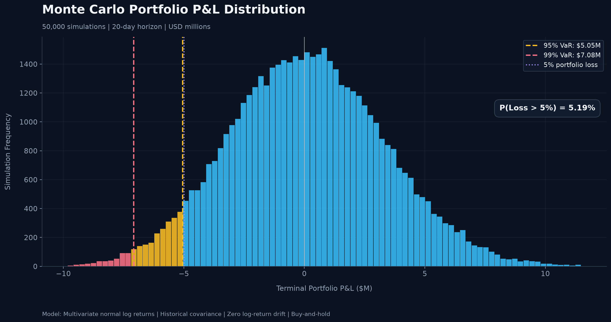
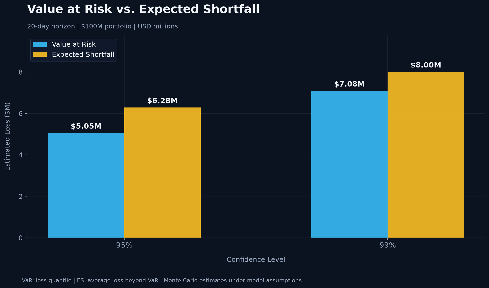
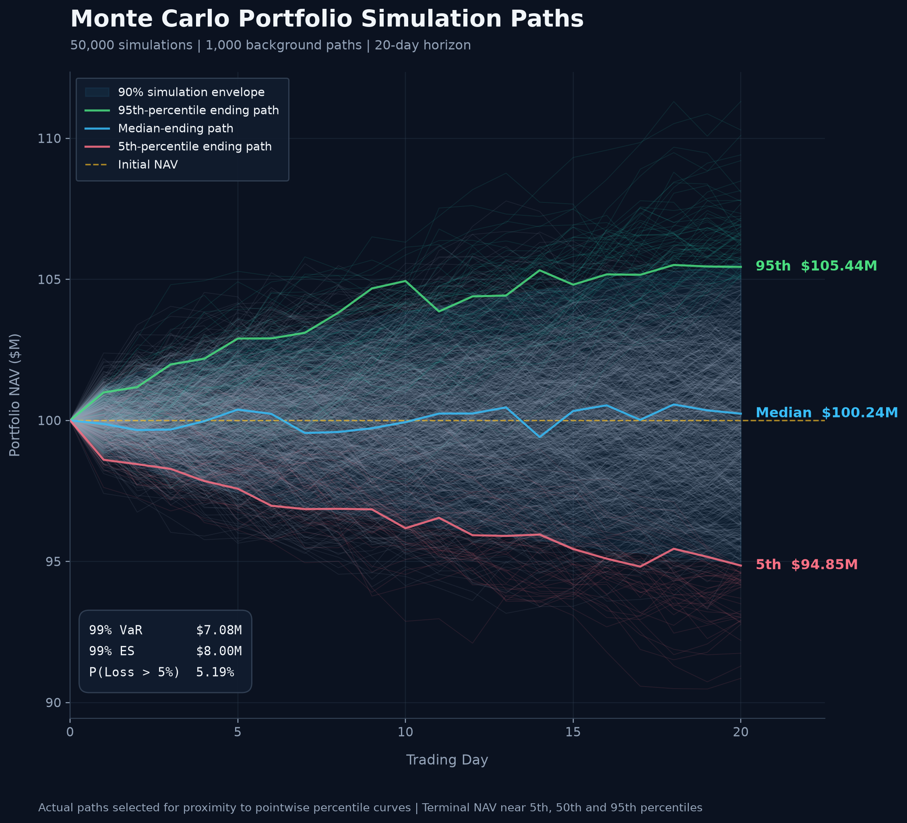

# Portfolio Risk & Loss Probability Simulation

## 1. Executive Summary

This project develops a Monte Carlo simulation framework to quantify the downside risk of a $100 million multi-asset ETF portfolio over a 20-trading-day horizon. Using historical return covariance estimates, the model generates 50,000 correlated return paths to estimate portfolio Value at Risk (VaR), Expected Shortfall (ES), and loss probabilities.

Under the baseline assumptions, the portfolio has a **99% VaR of $7.09 million**, a **99% ES of $8.00 million**, and a **5.19% probability of losing more than 5%** of its initial value. Model implementation checks and convergence analysis assess numerical reliability, while sensitivity analysis examines the impact of volatility, correlation, drift, and return distribution assumptions on estimated risk.

The results provide a quantitative assessment of potential portfolio losses and demonstrate how model assumptions influence downside risk estimates.

### Key Research Question

**What are the potential downside losses of a $100 million multi-asset portfolio over 20 trading days, as measured by Value at Risk (VaR), Expected Shortfall (ES), and loss probabilities?**

## 2. Portfolio Overview and Historical Data

### 2.1 Portfolio Composition

The analysis considers a hypothetical **$100 million multi-asset ETF portfolio** with exposures to U.S. equities, Treasury bonds, investment-grade corporate credit, and gold.

| ETF | Asset Class | Portfolio Weight | Initial Allocation |
|---|---|---:|---:|
| SPY | U.S. Large-Cap Equities | 30% | $30M |
| QQQ | Nasdaq-100 Equities | 15% | $15M |
| IEF | 7–10 Year U.S. Treasuries | 20% | $20M |
| TLT | 20+ Year U.S. Treasuries | 10% | $10M |
| LQD | Investment-Grade Corporate Bonds | 15% | $15M |
| GLD | Gold | 10% | $10M |
| **Total** | | **100%** | **$100M** |

The portfolio combines equity growth exposure with fixed-income and gold allocations, providing a basis for evaluating cross-asset diversification and portfolio-level downside risk.

### 2.2 Historical Data

Historical adjusted daily closing prices were retrieved from Yahoo Finance using `yfinance`, covering **January 2, 2020, through November 6, 2026**.

The dataset contains **1,721 daily log-return observations** across six ETFs. Daily logarithmic returns are calculated as:

$$
r_{i,t} = \ln\left(\frac{P_{i,t}}{P_{i,t-1}}\right)
$$

where $P_{i,t}$ denotes the adjusted closing price of asset $i$ on day $t$.

The historical return series is used to estimate the covariance and correlation matrices that determine the dependence structure of simulated asset returns.

### 2.3 Exploratory Market Risk Analysis

**Historical ETF Performance**

The chart compares cumulative ETF performance using adjusted closing prices normalized to an initial value of 100.

**Historical Asset Correlations**

The correlation heatmap illustrates historical relationships between daily asset returns.

The analysis highlights several portfolio risk characteristics:

- **Equities:** SPY and QQQ exhibit strong positive correlation (approximately 0.93), limiting diversification between the two equity positions.
- **Treasuries:** IEF and TLT are highly correlated (approximately 0.91), reflecting their shared interest-rate exposure.
- **Corporate credit:** LQD exhibits sensitivity to both Treasury yields and credit-market conditions.
- **Gold:** GLD exhibits relatively low historical correlations with equities, providing a potential source of diversification.

These relationships inform the baseline covariance structure used in the Monte Carlo simulation. However, historical correlations may change during periods of market stress.

## 3. Monte Carlo Simulation Methodology

### 3.1 Model Assumptions

The baseline model uses a multivariate Monte Carlo framework to simulate correlated asset returns and estimate portfolio downside risk.

| Parameter | Baseline Assumption |
|---|---|
| Initial Portfolio Value | $100 million |
| Simulation Horizon | 20 trading days |
| Number of Simulations | 50,000 |
| Asset Return Model | Multivariate normal daily log returns |
| Expected Daily Log Return | Zero for all assets |
| Volatility | Historical daily volatility |
| Correlation | Historical return correlation matrix |
| Covariance Estimation | Sample covariance of historical daily log returns |
| Portfolio Strategy | Buy-and-hold, without rebalancing |
| Risk Confidence Levels | 95% and 99% |
| Random Seed | 42 |

The model assumes that daily asset return vectors are independent and identically distributed over the simulation horizon, with constant covariance and normally distributed innovations. Transaction costs, financing costs, and portfolio rebalancing are excluded.

These assumptions establish a controlled baseline for evaluating portfolio risk and subsequent sensitivity analyses.

### 3.2 Correlated Return Simulation

Daily asset log returns are modeled as:

$$
\mathbf{r}_t \sim \mathcal{N}(\mathbf{0}, \Sigma)
$$

where $\Sigma$ is the historical covariance matrix estimated from the six ETF return series.

To preserve cross-asset dependence, correlated returns are generated using Cholesky decomposition:

$$
\Sigma = LL^\top
$$

$$
\mathbf{r}_t = L\mathbf{z}_t, \qquad
\mathbf{z}_t \sim \mathcal{N}(\mathbf{0}, I)
$$

Each simulation generates a sequence of 20 daily return vectors, producing 50,000 possible portfolio outcomes.

### 3.3 Portfolio Valuation and P&L

For each simulated path, the terminal value of asset $i$ is calculated by compounding its simulated log returns:

$$
V_{i,T} = V_{i,0}\exp\left(\sum_{t=1}^{T}r_{i,t}\right)
$$

The terminal portfolio value and profit or loss are:

$$
V_T = \sum_{i=1}^{6} V_{i,T}
$$

$$
P\&L_T = V_T - V_0
$$

where $V_{i,0} = w_i V_0$ is the initial allocation to asset $i$, $w_i$ is its portfolio weight, and $V_0 = \$100\text{ million}$.

Asset positions are held constant throughout each simulated path, allowing portfolio weights to drift with relative asset performance.

### 3.4 Risk Metrics

Risk measures are calculated from the simulated terminal portfolio P&L distribution.

**Value at Risk (VaR)** measures the loss threshold at a specified confidence level:

$$
VaR_\alpha = -Q_{1-\alpha}(P\&L_T)
$$

where $Q_{1-\alpha}$ is the lower-tail quantile of simulated P&L.

**Expected Shortfall (ES)** measures the average loss in outcomes at or beyond the VaR threshold:

$$
ES_\alpha = -E[P\&L_T \mid P\&L_T \leq -VaR_\alpha]
$$

**Probability of Loss** measures the proportion of simulated outcomes with negative terminal P&L:

$$
P(P\&L_T < 0)
$$

**Probability of Loss Exceeding 5%** measures the proportion of simulations in which the portfolio loses more than $5 million:

$$
P(P\&L_T < -0.05V_0)
$$

VaR and ES are evaluated at both 95% and 99% confidence levels. All reported risk estimates represent potential losses over the full 20-trading-day simulation horizon.

## 4. Simulation Results and Portfolio Risk Assessment

### 4.1 Simulated Portfolio P&L Distribution

The Monte Carlo model generates 50,000 potential portfolio outcomes over a 20-trading-day horizon. The resulting P&L distribution provides an estimate of potential gains and losses under the baseline model assumptions.

The simulation estimates a **48.94% probability of a portfolio loss** and a **5.19% probability of losing more than 5% of initial NAV ($5 million)** over the 20-day horizon.

The distribution reflects the combined effects of asset-level volatility, cross-asset correlations, and compounded returns. Particular attention is given to the left tail, which represents adverse portfolio outcomes and forms the basis for VaR and Expected Shortfall calculations.

### 4.2 Value at Risk and Expected Shortfall

The following table summarizes the portfolio's estimated downside risk at the 95% and 99% confidence levels.

| Risk Metric | 95% Confidence | 99% Confidence |
|---|---:|---:|
| Value at Risk (VaR) | $5.05M | $7.09M |
| Expected Shortfall (ES) | $6.29M | $8.00M |
| VaR as % of Initial NAV | 5.05% | 7.09% |
| ES as % of Initial NAV | 6.29% | 8.00% |

At the **99% confidence level**, VaR indicates a simulated loss threshold of approximately **$7.09 million**, exceeded in roughly 1% of modeled outcomes. Expected Shortfall estimates an average loss of **$8.00 million** among outcomes in the worst 1% of the simulated distribution.

The difference between VaR and ES highlights the additional loss severity beyond the VaR threshold. Both measures are conditional on the assumed return distribution and historical covariance structure.

### 4.3 Portfolio NAV Projections

The simulated portfolio NAV paths illustrate the range of potential portfolio values over the 20-trading-day horizon.

The fan chart displays the **5th–95th percentile** and **25th–75th percentile** NAV envelopes at each trading day, alongside a sample of simulated paths and representative trajectories.

The widening percentile ranges illustrate how uncertainty in portfolio value accumulates over the simulation horizon. The lower percentile trajectories provide a visual representation of downside scenarios, while the median trajectory serves as a reference for the central simulated outcome.

These percentile envelopes describe the distribution of NAV at each point in time; they do not represent confidence intervals for the estimated mean or guaranteed bounds for individual portfolio paths.

---------------------------------------

## Methodology

1. Construct a multi-asset portfolio covering equities, Treasury bonds, corporate credit, and gold.
2. Estimate historical asset returns, volatility, and correlations.
3. Generate correlated asset returns using Monte Carlo simulation.
4. Simulate portfolio values over a 20-trading-day horizon.
5. Calculate portfolio P&L distributions, Value at Risk (VaR), Expected Shortfall (ES), and loss probabilities.
6. Evaluate sensitivity to volatility and correlation assumptions under stressed market conditions.

## Exploratory Market Risk Analysis

### Historical ETF Performance

The chart below compares the cumulative performance of six ETFs
using adjusted closing prices normalized to an initial value of 100.

### Historical Asset Correlations

The correlation matrix illustrates relationships between daily
log returns across equities, Treasury bonds, corporate credit,
and gold.

### Preliminary Findings

- **Equity concentration:** SPY and QQQ exhibit a strong positive
  correlation of approximately 0.93, limiting diversification
  benefits between the two positions.
- **Treasury exposure:** IEF and TLT exhibit a correlation of
  approximately 0.91, reflecting shared interest-rate sensitivity.
- **Corporate credit:** LQD is positively correlated with both
  Treasury bonds and equities, reflecting its combined interest-rate
  and credit-spread exposures.
- **Gold diversification:** GLD exhibits relatively low historical
  correlations with equities, although its standalone volatility
  remains material.

These historical relationships form the basis for estimating
the covariance matrix used in the Monte Carlo simulation.

**Data period:** January 2020 – November 2026  
**Data source:** Yahoo Finance via yfinance  
**Methodology:** Daily adjusted prices and logarithmic returns

## Planned Visualizations

- Portfolio P&L Distribution
- Monte Carlo Portfolio Value Paths
- Portfolio Value Fan Chart
- Asset Correlation Heatmap
- Base vs. Stress Scenario Comparison
- Risk Metrics and Tail Loss Analysis

## Tools

Python, NumPy, pandas, SciPy, Matplotlib, Plotly

## Project Status

In Development
